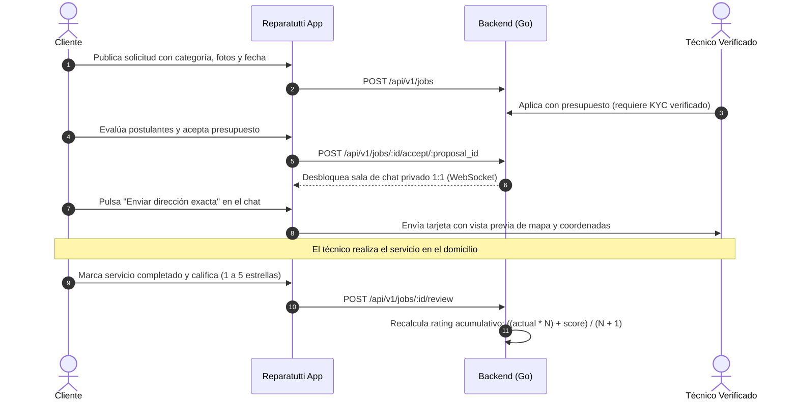
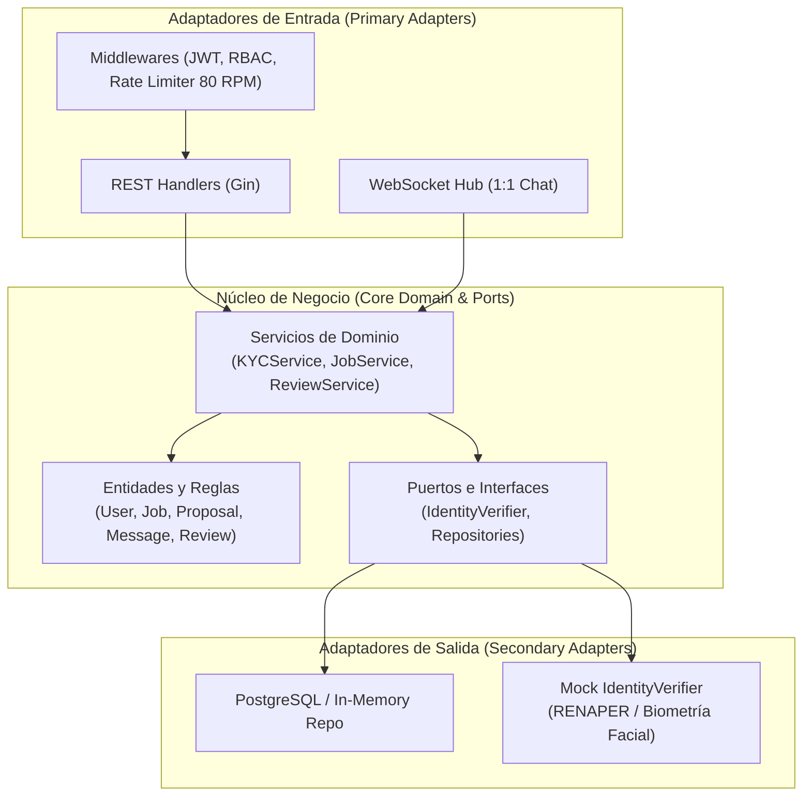

# Reparatutti 🛠️

Plataforma móvil multiplataforma (Flutter para iOS y Android) y backend cloud-native (Go 1.22+ con Arquitectura Hexagonal) que conecta a clientes con técnicos profesionales verificados en oficios del hogar (Electricidad, Pintura, Gas, Construcción, Flete y Reparación Edilicia).

Incluye validación biométrica de identidad (KYC), chat 1:1 en tiempo real aislado por servicio, compartición protegida de ubicación física y marco legal alineado a la legislación argentina (Ley 25.326 de Protección de Datos Personales y Ley 24.240 de Defensa del Consumidor).

---

## 🚀 Instrucciones de Ejecución

### Prerrequisitos
- **Go 1.22+** instalado.
- **Flutter 3.x / Dart 3.x** instalado con SDK configurado.
- (Opcional) **PostgreSQL 14+** si deseas aplicar la migración SQL física. El backend incluye almacenamiento en memoria automático para pruebas inmediatas sin dependencias externas.

---

### 1. Levantar el Backend (Go)

```bash
# 1. Ingresar al directorio del backend
cd backend

# 2. Descargar dependencias
go mod tidy

# 3. Iniciar el servidor
go run ./cmd/server
```

> El servidor iniciará en `http://localhost:8080` con datos iniciales precargados (*seed*) para pruebas:
> - **Cliente:** `cliente@reparatutti.com` / `Password123!`
> - **Técnico Verificado:** `tecnico.verificado@reparatutti.com` / `Password123!`
> - **Técnico Pendiente KYC:** `tecnico.pendiente@reparatutti.com` / `Password123!`

Para ejecutar la suite de pruebas unitarias:
```bash
go test -v ./...
```

---

### 2. Levantar la Aplicación Móvil (Flutter)

```bash
# 1. Ingresar al directorio móvil
cd mobile

# 2. Instalar paquetes de Flutter
flutter pub get

# 3. Ejecutar en emulador o dispositivo conectado
flutter run
```

Para validar análisis estático y pruebas:
```bash
flutter analyze
flutter test
```

---

## 📐 Características Generales y Diagramas

### Flujo Principal del Servicio



---

### Arquitectura Hexagonal del Backend



---

### Resumen de Funcionalidades Clave

| Módulo | Descripción |
| :--- | :--- |
| **Validación KYC** | Validación obligatoria para técnicos (DNI frente/dorso + selfie con prueba de vida) y biometría facial para clientes. Técnicos no verificados no pueden postularse. |
| **Privacidad de Ubicación** | La dirección exacta no se expone públicamente; el cliente la comparte explícitamente dentro del chat tras aceptar la propuesta. |
| **Marco Legal Argentino** | Flujo de consentimiento para **Ley 25.326** (Protección de Datos Personales), ejercicio de **Derechos ARCO** (AAIP) y **Ley 24.240** (Defensa del Consumidor). |
| **Chat en Tiempo Real** | Mensajería 1:1 en WebSocket aislada por `job_id` con tarjetas de vista previa de mapa y coordenadas geográficas. |
| **Diseño y UX** | Paleta personalizada (Mostaza, Negro, Blanco), soporte completo para **Light & Dark Mode** y **Skeleton Loaders (Shimmer)** para evitar bloqueos de interfaz. |